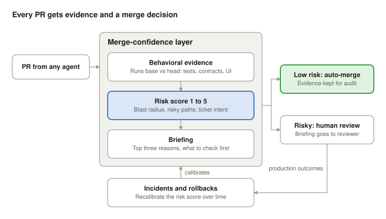

# Merge-Confidence Layer — One-Page Concept

*November 6, 2026*

**One-liner:** A neutral layer that decides which AI-written pull requests are safe to merge without a human, and gives a two-minute briefing on the ones that aren't.

## Problem

Coding agents made writing changes cheap, so review is now the bottleneck. Teams produce more PRs than senior engineers can read carefully.

- Review queues grow, and reviewers skim or rubber-stamp.
- Code that nobody on the team truly understands piles up in critical areas.
- Leaders can't say which AI changes are safe to automate, so they either block automation or accept unknown risk.

Existing tools answer "what does the code look like?" Nobody answers "what will this change do, and does it need a human?"

## Solution

Every PR, whether an agent or a human wrote it, gets three things before anyone reads the code.

- **Behavioral evidence:** what the change actually does, shown by running the old and new versions side by side.
- **Risk score:** blast radius, sensitivity of the touched area, drift from the ticket, and the agent's track record here.
- **Routing:** low-risk changes merge with evidence kept; risky ones go to the right reviewer with a briefing. Incidents feed back into the score.

## Target customer

Companies with 50 to 500 engineers that have already rolled out coding agents and now feel the review squeeze.

| Role | What they need |
| --- | --- |
| Economic buyer: VP Engineering or CTO | Ship more AI work without more incidents, and show it in numbers |
| Champion: staff engineer or platform lead | Less time reading low-risk PRs, a clear signal on the risky ones |
| Gatekeeper: security or compliance | An evidence trail for every automated merge |

**Beachhead:** European fintech, e-commerce and SaaS teams on GitHub or GitLab. Their change-control and audit needs make "proof before merge" worth paying for.

## Differentiation and moat

The moat is calibration: the risk model learns from each customer's own incidents, rollbacks and hotfixes, which no single-agent vendor sees.

| Alternative | What it does | Where it falls short |
| --- | --- | --- |
| AI code reviewers (CodeRabbit, Graphite, Qodo) | Comment on the diff | Opinions about code, not evidence of behavior; no merge decision |
| Platform agents (GitHub, Cursor, Atlassian) | Write the code and check their own work | Grade their own homework; see only their own agent's output |
| Ticket-to-PR orchestrators (Cobble and similar) | Shape the ticket and deliver a PR | Upstream of review; still hand reviewers a full PR to read |
| Human review only | Full judgment | Doesn't scale with agent output |

Neutrality matters: it works on PRs from any agent or human, so it gains value as teams mix tools.

## MVP scope

The MVP is a GitHub app that posts one evidence-backed briefing per PR. It does not merge anything yet.

**In:**

- GitHub app, TypeScript and Python repos first.
- Behavioral diff from running base and head: test outcomes, API contract changes, UI screenshot diffs.
- Blast-radius map from the dependency graph, with sensitive paths tagged by the team (payments, auth, migrations).
- Intent check: does the change match the linked ticket?
- Risk score from 1 to 5 with the top three reasons, plus a two-minute briefing as a PR comment.

**Out until proven:** auto-merge, traffic replay, GitLab and Azure, learning from incidents.

## Business model and pricing hypothesis

Charge per active repository, not per seat: as agents write more of the code, seat counts stop tracking value. All prices below are hypotheses to test with design partners.

| Tier | Hypothesis price | Includes |
| --- | --- | --- |
| Team | about €400 per repo per month | Briefings and risk scores |
| Business | about €900 per repo per month | Auto-merge routing, policy rules, audit export |
| Enterprise | Annual contract | Self-hosted runner, incident calibration, SSO |

Self-hosted runners keep code on the customer's infrastructure, matching what EU buyers already expect.

## 90-day validation plan and key risks

The goal for day 90 is three design partners using the briefing weekly, plus one signed paid pilot.

1. **Days 1–30: discovery.** Interview 20 engineering leaders who use coding agents heavily. Confirm review is their top AI pain and collect their incident history.
2. **Days 31–60: build.** Ship the GitHub app MVP to three design partners. Score their last 200 merged PRs and check whether high scores line up with past incidents.
3. **Days 61–90: prove.** Measure review time per PR and issues caught before merge. Convert one partner to a paid pilot.

**Kill or pivot if:** risk scores don't separate incident-causing PRs from safe ones, or leaders rank review below other AI pains.

| Risk | Mitigation |
| --- | --- |
| Platforms bundle "good enough" review for free | Stay agent-neutral and own calibration on customer incident data |
| Behavioral diffs are slow or flaky on real repos | Start with test and contract diffs; add replay only where it's stable |
| Teams won't trust automated merge | Advisory-only first; earn auto-merge per path with a measured track record |
| Customers resist sharing incident data | Self-hosted option; calibration stays inside their environment |
